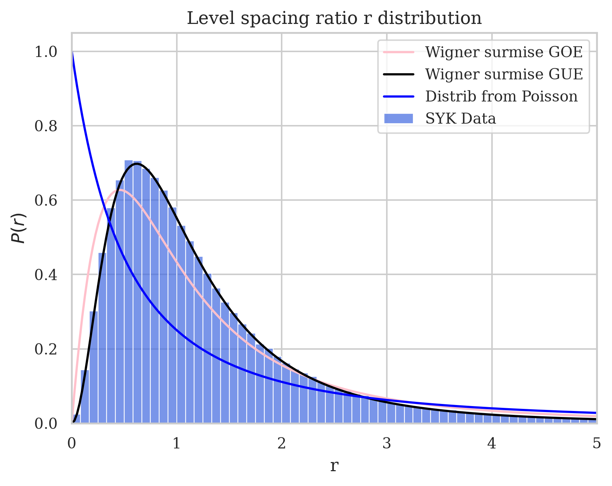
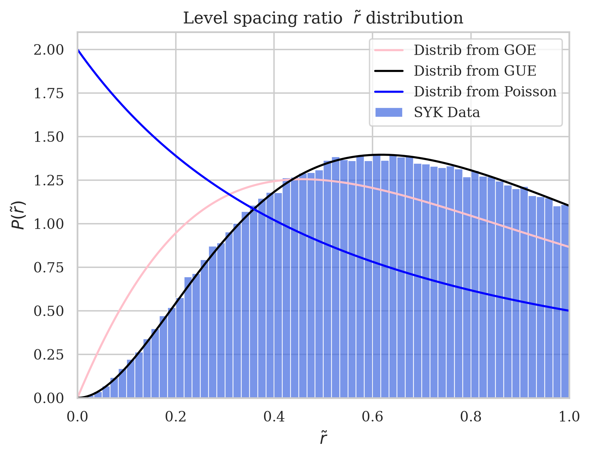
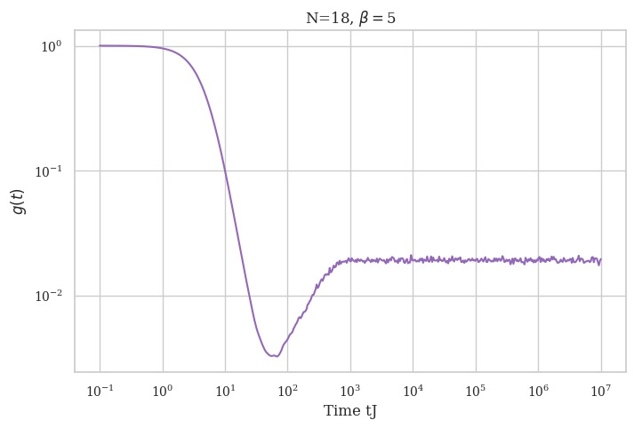
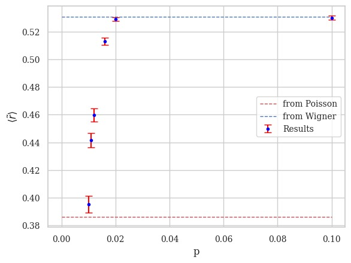
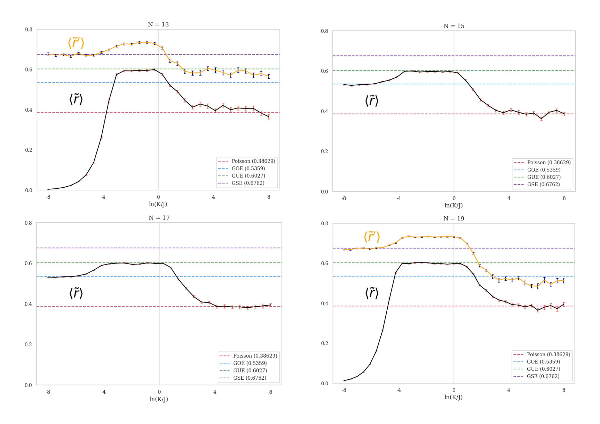
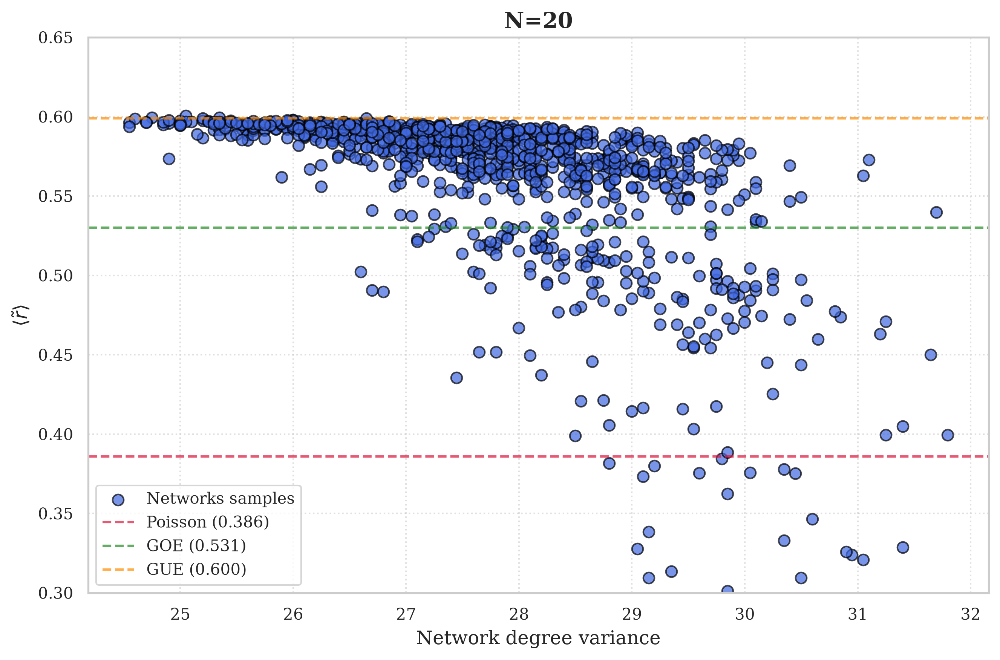
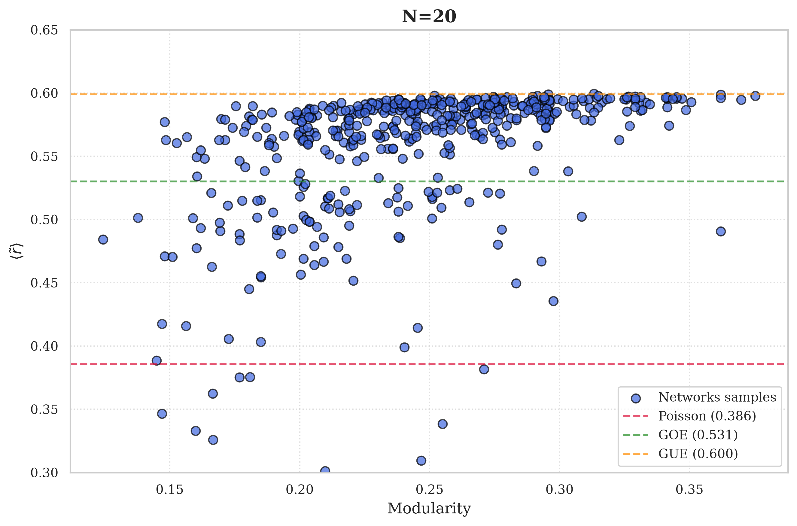

# Looking-for-chaos-in-SYK-like-models

Numerical study of chaotic properties of SYK-like models through level spacing ratio distribution and the related RMT ensembles. Given the energy spectrum labelled by $E_n$, level spacings are defined as: $\Delta E_n = E_{n+1}-E_n$. The whole projects uses the following definitions for level spacing ratios:

$$
  r_n = \frac{\Delta E_{n+1}}{\Delta E_n}, \; \tilde r_n = \text{min} \left\{ r_n, \frac{1}{r_{n}}\right\}
$$

In some of the models Chaos to Integrability crossovers have been studied. Only for standard SYK the spectral form factor has been computed.

Studied models are: SYK, Sparse SYK, Hybrid SYK, Complex SYK, SYK on growing simplicial complexes.

All the notebooks are based on CuPy library, which allows GPU acceleration. All the code has been tested on a Nvidia RTX 5070. It is possible to run all the code with NumPy, by substituting CuPy call "cp" with "np". Performance might be worse.

## Notebooks

### 1. Standard SYK
**File** [Complete_simp.ipynb](Complete_simp.ipynb)

Computation of level spacing ratio statistics for a model built from SYK allowing two,three and four-fermion interactions. Every interaction type can be turned off separately.

  
  

**Reference:** G. Sarosi. *AdS2 holography and the SYK model* (2019): [arXiv:1711.08482](https://arxiv.org/abs/1711.08482)

**File:** [SYK_SFF.ipynb](SYK_SFF.ipynb)

Computation of standard SYK Spectral Form Factor.

  

**Reference:** J.S. Cotler, G. Gur-Ari, M. Hanada, J. Polchinski, P. Saad, S. H. Shenker, D. Stanford, A. Streicher, M. Tezuka. *Black Holes and Random Matrices* (2018): [arXiv:1611.04650](https://arxiv.org/abs/1611.04650)

### 2. Sparse SYK
**File:** [Sparse_SYK.ipynb](Sparse_SYK.ipynb)

Study of an SYK-like model built on a random 4-uniform hypergraph, where each possible four-fermion interaction is included independently with probability p. Computation of level spacing ratio distribution. Analysis of a CtI crossover driven by p.

  

**Reference:** P. Orman, H. Gharibyan, J. Preskill. *Quantum chaos in the sparse SYK model* (2024): [arXiv:2403.13884](https://arxiv.org/abs/2403.13884)

### 3. Hybrid SYK
**File:** [Hybrid_SYK.ipynb](Hybrid_SYK/Hybrid_SYK.ipynb)

Computation of level spacing ratio statistics for an SYK-like model combining quadratic and quartic fermionic interactions. Random couplings variances are independently tunable.

**File:** [Hybrid_SYK_CtI.ipynb]([Hybrid_SYK/Hybrid_SYK_CtI.ipynb)

Study of the CtI crossover driven by the couplings ratio.

  

**Reference:** F. Sun, Y. Yi-Xiang, J. Ye, W.-M. Liu. *A new universal ratio in Random Matrix Theory and chaotic to integrable transition in Type-I and Type-II hybrid Sachdev-Ye-Kitaev models* (2021): [arXiv:1809.07577](https://arxiv.org/abs/1809.07577)

### 4. Complex SYK
**File:** [Complex_SYK.ipynb](Complex_SYK.ipynb)

Computation of the level spacing ratio statistics for Complex SYK model, distinguishing different charge sectors.

**Reference:** M. Berkooz, V. Narovlansky, H. Raj. *Complex Sachdev-Ye-Kitaev model in the double scaling limit* (2020): [arXiv:2006.13983](https://arxiv.org/abs/2006.13983)

### 5. SYK on growing simplicial complexes
Analysis of average level spacing ratio for a model built from SYK on growing simplicial complexes.

  
  

**References for theory and code about these networks:**  D. Febbe, D. Fanelli, T. Carletti. *Random Walks Across Dimensions: Exploring Simplicial Complexes* (2026): [arXiv:2601.16086](https://arxiv.org/abs/2601.16086).

D. Febbe, D. Fanelli, T. Carletti. *Model of Simplicial Complexes with dimension-wise preferential attachment* (2026): [arXiv:2605.17004](https://arxiv.org/abs/2605.17004). 

[GitHub repository](https://github.com/diegofebbe/Random_walk_on_simplicial_complexes)

## Dependencies
Python, NumPy, SciPy, CuPy, NetworkX, Matplotlib, Seaborn.
